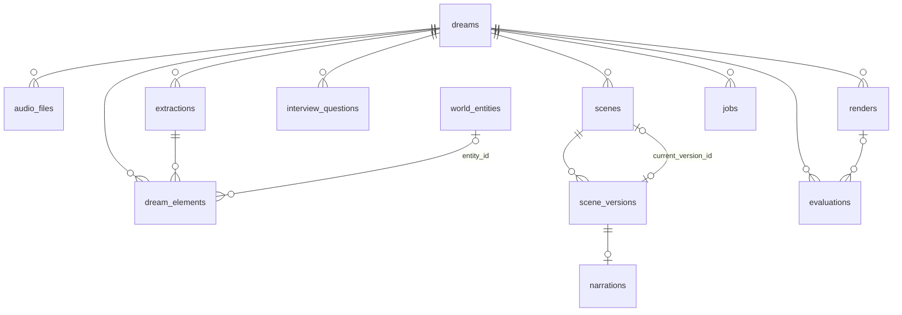

# 데이터 모델

담당: C2 · 코드 원본: `backend/app/models/` · 마이그레이션: `backend/alembic/versions/`

C 계획서 3.3과 DB 이관 문서 2장을 기준으로 한 12개 테이블입니다. 두 문서에 없는 컬럼은 넣지 않았습니다(`id`, `created_at`, `updated_at` 공통 규칙 제외). 컬럼이 필요하면 단톡방이나 이슈로 C2에게 요청해 주세요. 마이그레이션 파일은 C2만 만듭니다.

## ERD



`renders.scene_version_ids`(배열)와 `scene_versions.element_ids`(배열), `jobs.target_id`는 외래키 없이 id만 저장합니다.

## 공통 규칙

- 기본키 `id`는 자동 증가 bigint입니다. 파일 경로(`storage/paths.py`)가 이 id를 씁니다.
- 모든 테이블에 `created_at`, 값이 바뀌는 테이블에는 `updated_at`이 있습니다(`app/db/base.py`).
- 상태·종류 값은 문자열 + CHECK 제약입니다. 값 목록은 `app/core/enums.py`에서 가져오고, `tests/repositories/test_models.py`가 DB 제약과 enums.py가 같은지 검사합니다.
- 꿈 기록(`dreams`)을 지우면 딸린 데이터가 모두 함께 지워집니다(ON DELETE CASCADE).
- 파일은 `storage/`에 저장하고, DB에는 `storage/` 기준 상대 경로 문자열만 둡니다.
- `order`는 SQL 예약어라 직접 SQL을 쓸 때는 `"order"`처럼 따옴표로 감싸야 합니다.

## 무결성 규칙 (DB가 직접 막음)

코드에서 실수해도 데이터가 틀어지지 않도록 DB 제약·트리거로 지킵니다. 위반하면 `IntegrityError`가 납니다.

| 규칙 | 방법 |
| --- | --- |
| 상태 변경은 조건부로 | `repositories.dreams.transition_status`가 `WHERE status = 현재값`으로 변경. 동시 요청은 한 번만 성공 |
| 진행 중 작업 중복 금지 | `jobs` 부분 유니크 인덱스 `uq_jobs_active` (`NULLS NOT DISTINCT`) |
| 장면 버전은 추가만 | 트리거 `scene_versions_guard`: `scene_id`, `version_no`, `summary_ko`, `prompt_en`, `element_ids`는 수정 불가. `final_prompt`, `model`, `settings`, `seed`, `image_path`, `generated_at`, `confidence_level`은 비어 있을 때 한 번만 채울 수 있음. `status`는 변경 가능 |
| 영상의 장면 버전 고정 | 트리거 `renders_guard`: `scene_version_ids` 수정 불가 |
| 파일과 기록 구분 | 경로 컬럼(`audio_files.path`, `scene_versions.image_path`, `renders.video_path`, `narrations.audio_path`)은 상대 경로만. `/`·`\`·드라이브 문자(`C:`)로 시작하거나 `..`이 들어가면 거부 |
| 확신도는 사용자 입력만 | `save_extraction`은 확신도를 비워 두고, 값은 `set_confidences`로만 저장 (DB가 입력 주체를 구분할 수는 없어 함수 규칙으로 지킴) |

## 테이블

### dreams — 꿈 기록

| 컬럼 | 타입 | 설명 |
| --- | --- | --- |
| input_type | text | `voice`, `text` |
| status | text | `recorded`(기본) → `interviewing` → `scenes_ready` → `images_ready` → `rendered`, 앞으로만 이동 |
| raw_text | text, NULL | 입력 원문 또는 STT 결과 |
| confirmed_text | text, NULL | 사용자가 확정한 원문 |

인덱스: `created_at DESC` (꿈 일기 목록)

### audio_files — 음성 파일

| 컬럼 | 타입 | 설명 |
| --- | --- | --- |
| dream_id | FK dreams | |
| path | text | `dreams/{dreamId}/audio/{audioId}.webm` |
| mime_type | text | `audio/webm`, `audio/mp4`, `audio/x-m4a` |
| size | bigint | 바이트 |
| duration | float, NULL | 초 |

### extractions — 요소 추출 결과 (D 지표)

| 컬럼 | 타입 | 설명 |
| --- | --- | --- |
| dream_id | FK dreams | |
| phase | text | `raw`(원문 추출), `after_interview`(인터뷰 반영 재추출) |
| payload | jsonb | LLM 출력 원본 (`app/llm/schemas.py`) |
| element_count | int | 추출된 요소 수 |
| text_length | int | 추출에 쓴 텍스트 글자 수 |

### dream_elements — 요소

| 컬럼 | 타입 | 설명 |
| --- | --- | --- |
| dream_id | FK dreams | |
| extraction_id | FK extractions | 어느 추출에서 나왔는지 |
| type | text | `person`, `place`, `object`, `emotion` |
| name | text | 짧은 이름 (예: 할머니) |
| description | text | 꿈 속 묘사, 없으면 빈 문자열 |
| confidence | text, NULL | `high`, `medium`, `low`. **사용자 입력만 저장**, 입력 전에는 NULL |
| entity_id | FK world_entities, NULL | (선택) 세계관 인물·장소 연결 |

### interview_questions — 되묻기 질문

| 컬럼 | 타입 | 설명 |
| --- | --- | --- |
| dream_id | FK dreams | |
| order | int | 1부터, 꿈마다 중복 불가 |
| text | text | 질문 |
| target_element | text, NULL | 질문 대상 요소 name, 꿈 전체 질문이면 NULL |
| answer | text, NULL | 답변 |
| skipped | bool | "기억 안 남" |

진행 위치(answered/total)는 `answer IS NOT NULL OR skipped`인 질문 수로 계산합니다.

### scenes — 장면

| 컬럼 | 타입 | 설명 |
| --- | --- | --- |
| dream_id | FK dreams | |
| order | int | 1부터, 꿈마다 중복 불가 |
| current_version_id | FK scene_versions, NULL | 지금 보여 줄 버전 |

### scene_versions — 장면 버전 (덮어쓰지 않고 새 행 추가)

| 컬럼 | 타입 | 설명 |
| --- | --- | --- |
| scene_id | FK scenes | |
| version_no | int | 1부터, 장면마다 중복 불가 |
| summary_ko | text | 스토리보드 표시용 한국어 요약 (D) |
| prompt_en | text | 장면 프롬프트 (D) |
| element_ids | bigint[] | 이 장면에 나오는 dream_elements.id |
| confidence_level | text, NULL | E1 규칙으로 계산한 장면 확신도 `high`/`medium`/`low` |
| status | text | 이미지 생성 상태 `queued`(기본), `running`, `succeeded`, `failed` |
| final_prompt | text, NULL | 인물 외형·화풍을 붙여 실제로 보낸 프롬프트 (E2) |
| model | text, NULL | 이미지 생성 모델 (E2) |
| settings | jsonb | 생성 설정 (E2) |
| seed | bigint, NULL | (E2) |
| image_path | text, NULL | `dreams/{dreamId}/scenes/{sceneId}/v{versionNo}/original.png` |
| generated_at | timestamptz, NULL | 이미지 생성 완료 시각 (E2 요청) |

### renders — 영상

| 컬럼 | 타입 | 설명 |
| --- | --- | --- |
| dream_id | FK dreams | |
| status | text | `queued`(기본), `running`, `succeeded`, `failed` |
| video_path | text, NULL | `dreams/{dreamId}/renders/{renderId}/video.mp4` |
| width, height, duration | NULL | 결과 검증 값 (E1) |
| scene_version_ids | bigint[] | 렌더 시작 시 고정한 장면 버전 (장면 순서대로). 이후 바꾸지 않음 |
| postprocess_settings | jsonb | 블러 등 후처리 설정 (E1) |

`is_latest`는 저장하지 않고, `scene_version_ids`와 각 장면의 `current_version_id`를 비교해 계산합니다.

### jobs — 작업

| 컬럼 | 타입 | 설명 |
| --- | --- | --- |
| dream_id | FK dreams | |
| type | text | `generate_scenes`, `generate_image`, `render_video`, `generate_narration`, `revise_scene` |
| target_id | bigint, NULL | generate_image: scene_versions.id / render_video: renders.id / generate_narration·revise_scene: scenes.id / generate_scenes: NULL |
| status | text | `queued`(기본), `running`, `succeeded`, `failed` |
| stage | text, NULL | `docs/rules/job-status.md`의 처리 단계 |
| error_code | text, NULL | 실패 사유 코드 |
| error_message | text, NULL | |
| attempt | int | 시도 횟수 |
| started_at, finished_at | timestamptz, NULL | 처리 시간 지표에 사용 |

중복 방지: `(dream_id, type, target_id)`에 `status IN ('queued', 'running')`일 때만 적용되는 부분 유니크 인덱스(`uq_jobs_active`). `NULLS NOT DISTINCT`라서 target_id가 NULL인 generate_scenes도 꿈마다 하나만 진행됩니다.

### narrations — (선택) 나레이션

| 컬럼 | 타입 | 설명 |
| --- | --- | --- |
| scene_version_id | FK scene_versions | |
| audio_path | text | `.../v{versionNo}/narration.mp3` |
| duration | float, NULL | 초 |

### world_entities — (선택) 세계관 인물·장소

| 컬럼 | 타입 | 설명 |
| --- | --- | --- |
| name | text | |
| kind | text | `person`, `place` |
| hair, outfit, age_range, features | text, NULL | 외형 항목 (B2·E2와 통일) |

### evaluations — (선택) 평가 응답

| 컬럼 | 타입 | 설명 |
| --- | --- | --- |
| dream_id | FK dreams | |
| render_id | FK renders, NULL | |
| kind | text | 평가 종류 (E1·E2와 확정 후 CHECK 추가) |
| condition | text | 비교 조건 |
| score | smallint | 1~5 |

## 지표 뷰

검증 지표는 `SELECT * FROM 뷰이름`으로 바로 꺼낼 수 있습니다. 정의는 `backend/alembic/versions/5ccb1fbaa197_metric_views.py`.

```bash
docker compose exec db psql -U dream -d dream -c "SELECT * FROM v_interview_comparison"
```

### v_interview_comparison — 인터뷰 전후 비교 (D)

꿈 기록별 한 행. 원문 추출(`raw`)이 있는 꿈만 나오고, 같은 단계를 여러 번 추출했으면 마지막 것을 씁니다.

| 컬럼 | 설명 |
| --- | --- |
| dream_id, created_at | |
| raw_element_count, after_element_count | 인터뷰 전·후 요소 수 (인터뷰 전이면 after는 NULL) |
| element_increase | 요소 수 증가량 |
| raw_text_length, after_text_length | 추출에 쓴 텍스트 글자 수 (`save_extraction`의 text_length) |
| text_length_increase | 글자 수 증가량 |

평균 증가량: `SELECT avg(element_increase), avg(text_length_increase) FROM v_interview_comparison`

### v_confidence_evaluation — 확신도 평가 (E1)

`evaluations.kind = 'confidence'` 응답을 조건(`condition`)별로 묶습니다.

| 컬럼 | 설명 |
| --- | --- |
| condition | 비교 조건 (예: 블러 적용/미적용) |
| response_count | 응답 수 |
| avg_score | 5점 평가 평균 (소수 둘째 자리) |

### v_character_consistency — 인물 일관성 평가 (E2)

`evaluations.kind = 'character'` 응답을 조건별로 묶습니다. **점수 4 이상을 "같은 인물로 인식"으로 봅니다.**

| 컬럼 | 설명 |
| --- | --- |
| condition | 비교 조건 (예: 세계관 인물 적용/미적용) |
| response_count | 응답 수 |
| recognized_count | 같은 인물로 인식한 응답 수 |
| recognized_ratio | 인식 비율 (0~1, 소수 셋째 자리) |
| avg_score | 5점 평균 |

### v_processing_time — 처리 시간 (C, 전원)

성공한 작업이 하나라도 있는 꿈 기록별 한 행. 단위는 초, 해당 작업이 없으면 NULL.

| 컬럼 | 설명 |
| --- | --- |
| scene_split_seconds | 마지막으로 성공한 `generate_scenes`의 started_at~finished_at |
| image_gen_seconds | 성공한 `generate_image` 중 가장 먼저 시작~가장 늦게 끝난 시간 (장면 병렬 처리를 포함한 체감 시간) |
| image_job_count | 성공한 `generate_image` 수 |
| render_seconds | 마지막으로 성공한 `render_video`의 started_at~finished_at |

`started_at`, `finished_at`은 `repositories.jobs.update_job`이 상태를 바꿀 때 기록합니다.

> 뷰가 참조하는 컬럼을 바꾸는 마이그레이션은 먼저 뷰를 지우고(`DROP VIEW`) 다시 만들어야 합니다.

## 샘플·시연 데이터와 백업

### 샘플 데이터 (`backend/scripts/seed.py`)

익명 샘플 꿈 5건을 상태별로 1건씩 넣습니다. 실제 AI 처리 없이 화면을 확인할 때 씁니다.

| id | 상태 | 들어 있는 데이터 |
| --- | --- | --- |
| 1 | rendered | D의 예시 JSON(학교 복도) 그대로. 인터뷰 6문항(1개 기억 안 남), 재추출, 확신도, 장면 3개, 이미지, 완료된 영상 |
| 2 | images_ready | 장면 3개 이미지 완료, 영상 없음 |
| 3 | scenes_ready | 장면 3개 중 이미지 1개 완료, 1개 생성 중(running), 1개 대기(queued) |
| 4 | interviewing | 질문 5개 중 2개 진행 (답변 1, 기억 안 남 1) |
| 5 | recorded | 음성 입력, 원문 확정 전 |

- DB에는 경로 문자열만 들어가고 이미지·영상 파일은 만들지 않습니다.
- 1번 외 4건은 임시 문장입니다. D의 익명화 테스트 데이터가 정리되면 `SAMPLE_DREAMS`를 교체합니다.
- **실제 참가자의 꿈 기록은 샘플·저장소·외부에 공유하지 않습니다.** 사용자 테스트가 끝난 뒤 원문을 지우고 지표만 남길지는 팀에서 정합니다.

### 초기화 (`backend/scripts/reset_db.py`)

로컬 DB의 테이블을 모두 지우고 `alembic upgrade head` → `seed.py` 순서로 다시 만듭니다. `APP_ENV=local`이고 DB 주소가 localhost일 때만 실행되며, 실행 전에 확인을 묻습니다(`--yes`로 생략, `--no-seed`로 샘플 제외).

### 백업 (기능 동결일 11/28)

시연에 쓸 DB를 파일로 남기고, 필요하면 그대로 되돌립니다. 백업 파일은 Git에 올리지 않습니다.

```bash
# 백업 (저장소 루트에서)
docker compose exec -T db pg_dump -U dream -d dream --format=custom > backup_20261128.dump

# 복원 (기존 데이터를 지우고 백업 시점으로)
docker compose exec -T db pg_restore -U dream -d dream --clean --if-exists < backup_20261128.dump
```
